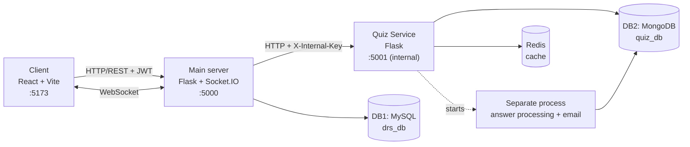

# Quiz Platform

**English** | [Srpski](README.sr.md)

A web platform for creating, reviewing and playing quizzes. Moderators create quizzes, administrators approve or reject them in real time, and players solve them against the clock. Answers are processed asynchronously in a separate process, the result is sent by email, and every quiz has its own leaderboard.

## Table of Contents

- [Features](#features)
- [Tech Stack](#tech-stack)
- [Architecture](#architecture)
- [Prerequisites](#prerequisites)
- [Installation](#installation)
- [Usage](#usage)
- [Configuration](#configuration)
- [Contact](#contact)

## Features

- **User accounts** – registration, login with JWT, profile editing with a profile image; passwords are stored hashed (bcrypt)
- **Login protection** – after 3 wrong passwords the account is blocked for 1 minute
- **Roles** – `PLAYER`, `MODERATOR` and `ADMIN`; the administrator assigns roles and the user is notified by email
- **Creating quizzes** – a moderator enters the title, duration (in seconds), 1–n questions, 2–m options per question, points per question and one or more correct answers
- **Real-time review** – a new or edited quiz appears to the administrator immediately (WebSocket); the administrator approves it or rejects it with a written reason
- **Editing rejected quizzes** – the moderator sees the rejection reason, fixes the quiz and sends it for approval again
- **Deleting quizzes** – moderators can delete their own quizzes, administrators can delete any quiz
- **Playing quizzes** – a timer starts when the quiz is opened and the answers are submitted automatically when the time runs out
- **Asynchronous processing** – answers are processed in a separate process (with a simulated delay), so the player can keep using the platform
- **Email results** – the player receives the score and time spent by email; results are saved in the database
- **Leaderboard** – for every quiz: player, points and time spent
- **Redis cache** – the list of published quizzes and the leaderboards are cached
- **PDF report** – the administrator can download a summary report of all quizzes
- **Validation** – on both the client and the server side

## Tech Stack

| Layer               | Technology                                                  |
| ------------------- | ----------------------------------------------------------- |
| Frontend            | React 19 (Vite), TypeScript, Tailwind CSS, Socket.IO client |
| Main server         | Python, Flask, Flask-SocketIO, Flask-JWT-Extended           |
| Quiz Service        | Python, Flask, `multiprocessing`                            |
| DB1 (users)         | MySQL                                                       |
| DB2 (quizzes)       | MongoDB                                                     |
| ORM / ODM           | SQLAlchemy (MySQL), PyMongo (MongoDB)                       |
| Cache               | Redis (run with Docker)                                     |
| Real-time           | WebSocket (Socket.IO)                                       |
| Authentication      | JWT, passwords hashed with bcrypt                           |

## Architecture

The browser communicates **only with the main server**. The main server checks the JWT and the user's role, and forwards every quiz request to the Quiz Service with a secret internal key. The Quiz Service listens only on `127.0.0.1` and rejects every request without that key, so it can never be called directly from the browser.

| Component      | Folder          | Responsibility                                                                                         | Storage                                 |
| -------------- | --------------- | ------------------------------------------------------------------------------------------------------ | --------------------------------------- |
| Client         | `client/`       | User interface (port 5173)                                                                             | —                                       |
| Main server    | `server/`       | Registration, login (JWT), users and roles, forwarding quiz requests, WebSocket notifications (port 5000) | **DB1** – MySQL `drs_db`               |
| Quiz Service   | `quiz_service/` | Creating, editing, deleting and reviewing quizzes, processing answers, leaderboard (port 5001, internal) | **DB2** – MongoDB `quiz_db`, Redis cache |

Both backend services use the same layered structure: **Controller → Service → Repository → Database**, with DTO classes for the data exchanged between the frontend, the main server and the Quiz Service.

### System architecture



### Quiz lifecycle

1. A **moderator** creates a quiz → status `PENDING` → the **administrator** receives it in real time (WebSocket).
2. The administrator **approves** it → status `APPROVED` → the quiz becomes visible to players in real time,
   or **rejects** it with a reason → status `REJECTED` → the moderator is notified, edits the quiz and it goes back to `PENDING`.
3. A **player** plays the quiz → the answers are saved with status `PROCESSING` and a separate process is started → the request returns immediately.
4. The process waits (simulated long processing), calculates the points, saves the result (`DONE`) and sends it by email → the result appears on the leaderboard.

### Database model

**DB1 – MySQL (`drs_db`)**, table `users` (created automatically):

| Column                                   | Description                              |
| ---------------------------------------- | ---------------------------------------- |
| `id`                                     | Primary key                              |
| `email`                                  | Unique                                   |
| `password_hash`                          | bcrypt hash                              |
| `first_name`, `last_name`                | Name                                     |
| `date_of_birth`, `gender`                | Personal data                            |
| `country`, `street`, `street_number`     | Address                                  |
| `role`                                   | `PLAYER`, `MODERATOR` or `ADMIN`         |
| `profile_image`                          | Path to the uploaded image               |
| `failed_attempts`, `blocked_until`       | Login protection                         |
| `created_at`, `updated_at`               | Timestamps                               |

**DB2 – MongoDB (`quiz_db`)**, collections created automatically:

`quizzes` – one document per quiz, questions are embedded:

```json
{
  "_id": "ObjectId",
  "title": "Geography",
  "duration": 60,
  "author_id": 2,
  "author_name": "John Doe",
  "author_email": "john@example.com",
  "status": "PENDING | APPROVED | REJECTED",
  "rejection_reason": null,
  "questions": [
    {
      "text": "Which rivers flow through Belgrade?",
      "options": ["Sava", "Danube", "Morava"],
      "correct_answers": ["Sava", "Danube"],
      "points": 3
    }
  ],
  "created_at": "date"
}
```

`results` – one document per played quiz:

```json
{
  "_id": "ObjectId",
  "quiz_id": "id of the quiz",
  "quiz_title": "Geography",
  "user_id": 5,
  "user_name": "Jane Doe",
  "user_email": "jane@example.com",
  "answers": [{ "question_index": 0, "selected": ["Sava", "Danube"] }],
  "time_spent": 42,
  "score": 3,
  "max_score": 5,
  "correct_count": 1,
  "status": "PROCESSING | DONE",
  "created_at": "date",
  "finished_at": "date"
}
```

A question brings its points only if the player selects **exactly** all correct answers.

## Prerequisites

Make sure you have the following installed:

- **Python 3.12** (with `pip`)
- **Node.js** 20.19+ or 22.12+ and **npm**
- **MySQL Server 8** (optionally **MySQL Workbench**)
- **MongoDB Community Server** running on `localhost:27017` (optionally **MongoDB Compass**)
- **Docker Desktop** – only for Redis (optional: without Redis the application works, just without the cache)
- **Git**
- A **Gmail account with an App Password** – optional, needed only for sending emails

## Installation

All commands below are for **Windows PowerShell**. On Linux/macOS use `source venv/bin/activate` instead of `.\venv\Scripts\Activate.ps1`.

### 1. Clone the repository

```bash
git clone https://github.com/miroslavdispiter/quiz-platform.git
cd quiz-platform
```

### 2. Create the MySQL database (DB1)

The script `server/db_setup.sql` creates the database `drs_db` and the user `drs_user` (password `DrsPass123!`).

**Option A – MySQL Workbench:** open `server/db_setup.sql` (**File → Open SQL Script**) and run it (⚡ **Execute**).

**Option B – terminal:**

```powershell
Get-Content server\db_setup.sql | mysql -u root -p
```

> The **tables do not have to be created manually** – the main server creates the `users` table automatically on its first start (`db.create_all()`).

### 3. Start MongoDB (DB2)

Make sure the MongoDB service is running (e.g. `Get-Service MongoDB` shows `Running`, or connect to `mongodb://localhost:27017` with MongoDB Compass).

> Nothing has to be created manually – the database `quiz_db` and the collections `quizzes` and `results` are created automatically when the first quiz is saved.

### 4. Start Redis (optional)

Start Docker Desktop, then in the root folder of the project run:

```powershell
docker compose up -d
```

Check that Redis is running:

```powershell
docker exec -it quiz-redis redis-cli ping
```

The answer should be `PONG`. Redis is now running on `localhost:6379` and will start automatically together with Docker Desktop. To stop it: `docker compose stop`.

### 5. Create the configuration files

Copy the example files and fill them in as described in the [Configuration](#configuration) section:

```powershell
Copy-Item server\.env.example server\.env
Copy-Item quiz_service\.env.example quiz_service\.env
Copy-Item client\.env.example client\.env
```

### 6. Run the Quiz Service

```powershell
cd quiz_service
python -m venv venv
.\venv\Scripts\Activate.ps1
pip install -r requirements.txt
python main.py
```

The Quiz Service runs on `http://127.0.0.1:5001` (reachable only by the main server). Leave this terminal open.

> If PowerShell refuses to run `Activate.ps1`, run once: `Set-ExecutionPolicy -Scope CurrentUser RemoteSigned`

### 7. Run the main server

In a **new terminal**, from the root folder of the project:

```powershell
cd server
python -m venv venv
.\venv\Scripts\Activate.ps1
pip install -r requirements.txt
python main.py
```

The main server runs on `http://localhost:5000`. On the first start it creates the `users` table in MySQL. Leave this terminal open.

### 8. Run the frontend

In a **new terminal**, from the root folder of the project:

```powershell
cd client
npm install
npm run dev
```

The application is available at `http://localhost:5173`.

### 9. Create the first administrator

Every new account is registered as `PLAYER`, so the first administrator is set directly in the database:

1. Open `http://localhost:5173` and register a new account.
2. In MySQL Workbench (or the `mysql` terminal) run:

```sql
USE drs_db;
UPDATE users SET role = 'ADMIN' WHERE email = 'your-email@example.com';
```

3. **Log out and log in again** – the role is stored in the login token, so it changes only after a new login.

From now on the administrator assigns the `MODERATOR` role to other users through the application.

## Usage

Once the Quiz Service, the main server and the frontend are running, open `http://localhost:5173`.

> To try the real-time features, log in with different users in **different browsers** (or a normal and an incognito window), because one browser keeps only one logged-in user.

**Administrator**

1. Open **Users** and change the role of a user to `MODERATOR` (the user receives an email).
2. Open **Review Quizzes** – new and edited quizzes appear here in real time.
3. Click **Review** to see the questions with the correct answers, then **Approve** or **Reject** (a rejection reason is required).
4. Delete any quiz or download the **PDF report**.

**Moderator**

1. Open **Create Quiz**, enter the title, duration in seconds and the questions; check the correct options (one or more).
2. In **Review Quizzes** (the moderator's list of own quizzes) follow the status – approval or rejection arrives in real time.
3. For a rejected quiz click **Review Rejection** to read the reason and **Edit Quiz** to fix it and send it again.

**Player**

1. Open **Quizzes** – newly approved quizzes appear without refreshing the page.
2. Click **Play Quiz** – the timer starts; select the answers and click **Submit Quiz** (or wait for the time to run out).
3. Continue using the platform – after about `PROCESSING_DELAY_SECONDS` the result arrives by email.
4. Click **View Leaderboard** to see the ranking: player, points and time spent.

## Configuration

> **Note:**
> - `INTERNAL_API_KEY` must have **the same value** in `server/.env` and `quiz_service/.env` – otherwise the main server cannot call the Quiz Service.
> - Replace `JWT_SECRET_KEY` with your own random string of at least 32 characters.
> - `DB_USER` and `DB_PASSWORD` must match the user created by `server/db_setup.sql`.
> - For Gmail use an **App Password** (Google Account → Security → 2-Step Verification → App passwords), not your real password. Without email settings everything works, only the emails are not sent.
> - Do not commit `.env` files with real secrets to the repository.

### Main server

`server/.env`

```env
DB_HOST=localhost
DB_PORT=3306
DB_NAME=drs_db
DB_USER=drs_user
DB_PASSWORD=DrsPass123!

JWT_SECRET_KEY=your-very-strong-secret-key-min-32-characters-long!

# Quiz Service (the main server forwards all quiz requests to it)
QUIZ_SERVICE_URL=http://localhost:5001
# Must be the same value as INTERNAL_API_KEY in quiz_service/.env
INTERNAL_API_KEY=your-internal-key

SMTP_HOST=smtp.gmail.com
SMTP_PORT=587
EMAIL_USER=your-email@gmail.com
EMAIL_PASS=your-app-password
EMAIL_FROM=Quiz Platform <your-email@gmail.com>
```

### Quiz Service

`quiz_service/.env`

```env
PORT=5001

# MongoDB (DB2)
MONGO_URI=mongodb://localhost:27017/
DB_NAME=quiz_db

# Must be the same value as INTERNAL_API_KEY in server/.env
INTERNAL_API_KEY=your-internal-key

# How long the quiz processing lasts (seconds), to simulate a slow processing
PROCESSING_DELAY_SECONDS=10

# Redis cache (if Redis is not running, the service reads directly from MongoDB)
REDIS_URL=redis://localhost:6379/0
# How long data stays in the cache (seconds)
CACHE_TTL_SECONDS=300

SMTP_HOST=smtp.gmail.com
SMTP_PORT=587
EMAIL_USER=your-email@gmail.com
EMAIL_PASS=your-app-password
EMAIL_FROM=Quiz Platform <your-email@gmail.com>
```

### Frontend

`client/.env`

```env
VITE_API_URL=http://localhost:5000/api
VITE_SOCKET_URL=http://localhost:5000
```

## Contact

**Miroslav Dišpiter**

- GitHub: [@miroslavdispiter](https://github.com/miroslavdispiter)
- Email: miroslav.dispiter.it@gmail.com
