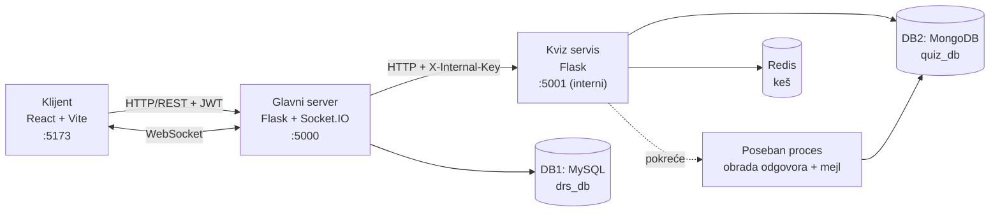

# Quiz Platform

[English](README.md) | **Srpski**

Web platforma za kreiranje, odobravanje i igranje kvizova. Moderatori kreiraju kvizove, administratori ih u realnom vremenu odobravaju ili odbijaju, a igrači ih rešavaju uz tajmer. Odgovori se obrađuju asinhrono u posebnom procesu, rezultat stiže mejlom, a svaki kviz ima svoju rang listu.

## Sadržaj

- [Funkcionalnosti](#funkcionalnosti)
- [Tehnologije](#tehnologije)
- [Arhitektura](#arhitektura)
- [Preduslovi](#preduslovi)
- [Instalacija](#instalacija)
- [Korišćenje](#korišćenje)
- [Konfiguracija](#konfiguracija)
- [Kontakt](#kontakt)

## Funkcionalnosti

- **Korisnički nalozi** – registracija, prijava preko JWT-a, izmena profila sa profilnom slikom; lozinke se čuvaju heširane (bcrypt)
- **Zaštita prijave** – posle 3 pogrešne lozinke nalog se blokira na 1 minut
- **Uloge** – `PLAYER`, `MODERATOR` i `ADMIN`; administrator dodeljuje uloge, a korisnik dobija obaveštenje mejlom
- **Kreiranje kvizova** – moderator unosi naziv, trajanje (u sekundama), 1–n pitanja, 2–m ponuđenih odgovora po pitanju, broj bodova po pitanju i jedan ili više tačnih odgovora
- **Odobravanje u realnom vremenu** – nov ili izmenjen kviz se odmah prikazuje administratoru (WebSocket); administrator ga odobrava ili odbija uz pisani razlog
- **Izmena odbijenih kvizova** – moderator vidi razlog odbijanja, ispravlja kviz i ponovo ga šalje na odobravanje
- **Brisanje kvizova** – moderator briše svoje kvizove, administrator bilo koji
- **Igranje kvizova** – pri otvaranju kviza pokreće se tajmer, a odgovori se sami šalju kad vreme istekne
- **Asinhrona obrada** – odgovori se obrađuju u posebnom procesu (uz simulirano kašnjenje), pa igrač može da nastavi rad na platformi
- **Rezultat mejlom** – igrač dobija broj bodova i utrošeno vreme mejlom; rezultati se čuvaju u bazi
- **Rang lista** – za svaki kviz: igrač, bodovi i utrošeno vreme
- **Redis keš** – keširaju se lista objavljenih kvizova i rang liste
- **PDF izveštaj** – administrator može da preuzme zbirni izveštaj svih kvizova
- **Validacija** – i na klijentskoj i na serverskoj strani

## Tehnologije

| Sloj                | Tehnologija                                                 |
| ------------------- | ----------------------------------------------------------- |
| Frontend            | React 19 (Vite), TypeScript, Tailwind CSS, Socket.IO klijent |
| Glavni server       | Python, Flask, Flask-SocketIO, Flask-JWT-Extended           |
| Kviz servis         | Python, Flask, `multiprocessing`                            |
| DB1 (korisnici)     | MySQL                                                       |
| DB2 (kvizovi)       | MongoDB                                                     |
| ORM / ODM           | SQLAlchemy (MySQL), PyMongo (MongoDB)                       |
| Keš                 | Redis (pokreće se preko Dockera)                            |
| Realno vreme        | WebSocket (Socket.IO)                                       |
| Autentifikacija     | JWT, lozinke heširane bcrypt-om                             |

## Arhitektura

Pregledač komunicira **samo sa glavnim serverom**. Glavni server proverava JWT i ulogu korisnika i svaki zahtev vezan za kvizove prosleđuje kviz servisu uz tajni interni ključ. Kviz servis sluša samo na `127.0.0.1` i odbija svaki zahtev bez tog ključa, tako da mu pregledač nikada ne može direktno pristupiti.

| Komponenta     | Folder          | Zaduženje                                                                                                      | Skladište                                |
| -------------- | --------------- | -------------------------------------------------------------------------------------------------------------- | ---------------------------------------- |
| Klijent        | `client/`       | Korisnički interfejs (port 5173)                                                                               | —                                        |
| Glavni server  | `server/`       | Registracija, prijava (JWT), korisnici i uloge, prosleđivanje zahteva za kvizove, WebSocket obaveštenja (port 5000) | **DB1** – MySQL `drs_db`               |
| Kviz servis    | `quiz_service/` | Kreiranje, izmena, brisanje i odobravanje kvizova, obrada odgovora, rang lista (port 5001, interni)           | **DB2** – MongoDB `quiz_db`, Redis keš   |

Oba backend servisa imaju istu slojevitu strukturu: **Controller → Service → Repository → baza**, uz DTO klase za podatke koji se razmenjuju između frontenda, glavnog servera i kviz servisa.

### Arhitektura sistema



### Životni ciklus kviza

1. **Moderator** kreira kviz → status `PENDING` → **administrator** ga dobija u realnom vremenu (WebSocket).
2. Administrator ga **odobrava** → status `APPROVED` → kviz se u realnom vremenu pojavljuje igračima,
   ili ga **odbija** uz razlog → status `REJECTED` → moderator dobija obaveštenje, menja kviz i on se vraća u `PENDING`.
3. **Igrač** igra kviz → odgovori se čuvaju sa statusom `PROCESSING` i pokreće se poseban proces → zahtev se odmah vraća.
4. Proces sačeka (simulacija duže obrade), izračuna bodove, sačuva rezultat (`DONE`) i pošalje ga mejlom → rezultat se pojavljuje na rang listi.

### Model baze podataka

**DB1 – MySQL (`drs_db`)**, tabela `users` (pravi se automatski):

| Kolona                                   | Opis                                     |
| ---------------------------------------- | ---------------------------------------- |
| `id`                                     | Primarni ključ                           |
| `email`                                  | Jedinstven                               |
| `password_hash`                          | bcrypt heš                               |
| `first_name`, `last_name`                | Ime i prezime                            |
| `date_of_birth`, `gender`                | Lični podaci                             |
| `country`, `street`, `street_number`     | Adresa                                   |
| `role`                                   | `PLAYER`, `MODERATOR` ili `ADMIN`        |
| `profile_image`                          | Putanja do otpremljene slike             |
| `failed_attempts`, `blocked_until`       | Zaštita prijave                          |
| `created_at`, `updated_at`               | Vreme kreiranja i izmene                 |

**DB2 – MongoDB (`quiz_db`)**, kolekcije se prave automatski:

`quizzes` – jedan dokument po kvizu, pitanja su ugnežđena:

```json
{
  "_id": "ObjectId",
  "title": "Geografija",
  "duration": 60,
  "author_id": 2,
  "author_name": "Petar Petrović",
  "author_email": "petar@example.com",
  "status": "PENDING | APPROVED | REJECTED",
  "rejection_reason": null,
  "questions": [
    {
      "text": "Koje reke teku kroz Beograd?",
      "options": ["Sava", "Dunav", "Morava"],
      "correct_answers": ["Sava", "Dunav"],
      "points": 3
    }
  ],
  "created_at": "datum"
}
```

`results` – jedan dokument po odigranom kvizu:

```json
{
  "_id": "ObjectId",
  "quiz_id": "id kviza",
  "quiz_title": "Geografija",
  "user_id": 5,
  "user_name": "Ana Anić",
  "user_email": "ana@example.com",
  "answers": [{ "question_index": 0, "selected": ["Sava", "Dunav"] }],
  "time_spent": 42,
  "score": 3,
  "max_score": 5,
  "correct_count": 1,
  "status": "PROCESSING | DONE",
  "created_at": "datum",
  "finished_at": "datum"
}
```

Pitanje donosi bodove samo ako igrač izabere **tačno** sve tačne odgovore.

## Preduslovi

Potrebno je da imate instalirano:

- **Python 3.12** (sa `pip`-om)
- **Node.js** 20.19+ ili 22.12+ i **npm**
- **MySQL Server 8** (opciono **MySQL Workbench**)
- **MongoDB Community Server** pokrenut na `localhost:27017` (opciono **MongoDB Compass**)
- **Docker Desktop** – samo za Redis (opciono: bez Redisa aplikacija radi, samo bez keša)
- **Git**
- **Gmail nalog sa App Password-om** – opciono, potreban samo za slanje mejlova

## Instalacija

Sve komande ispod su za **Windows PowerShell**. Na Linux/macOS-u umesto `.\venv\Scripts\Activate.ps1` koristite `source venv/bin/activate`.

### 1. Klonirajte repozitorijum

```bash
git clone https://github.com/miroslavdispiter/quiz-platform.git
cd quiz-platform
```

### 2. Napravite MySQL bazu (DB1)

Skripta `server/db_setup.sql` pravi bazu `drs_db` i korisnika `drs_user` (lozinka `DrsPass123!`).

**Opcija A – MySQL Workbench:** otvorite `server/db_setup.sql` (**File → Open SQL Script**) i pokrenite je (⚡ **Execute**).

**Opcija B – terminal:**

```powershell
Get-Content server\db_setup.sql | mysql -u root -p
```

> **Tabele ne treba praviti ručno** – glavni server pri prvom pokretanju sam pravi tabelu `users` (`db.create_all()`).

### 3. Pokrenite MongoDB (DB2)

Proverite da MongoDB servis radi (npr. `Get-Service MongoDB` prikazuje `Running`, ili se povežite na `mongodb://localhost:27017` preko MongoDB Compass-a).

> Ništa ne treba praviti ručno – baza `quiz_db` i kolekcije `quizzes` i `results` prave se automatski kad se sačuva prvi kviz.

### 4. Pokrenite Redis (opciono)

Pokrenite Docker Desktop, a zatim u korenskom folderu projekta:

```powershell
docker compose up -d
```

Proverite da Redis radi:

```powershell
docker exec -it quiz-redis redis-cli ping
```

Odgovor treba da bude `PONG`. Redis sada radi na `localhost:6379` i sam se pokreće zajedno sa Docker Desktop-om. Zaustavljanje: `docker compose stop`.

### 5. Napravite konfiguracione fajlove

Kopirajte primere i popunite ih kako je opisano u odeljku [Konfiguracija](#konfiguracija):

```powershell
Copy-Item server\.env.example server\.env
Copy-Item quiz_service\.env.example quiz_service\.env
Copy-Item client\.env.example client\.env
```

### 6. Pokrenite kviz servis

```powershell
cd quiz_service
python -m venv venv
.\venv\Scripts\Activate.ps1
pip install -r requirements.txt
python main.py
```

Kviz servis radi na `http://127.0.0.1:5001` (dostupan je samo glavnom serveru). Ostavite ovaj terminal otvoren.

> Ako PowerShell ne dozvoli pokretanje `Activate.ps1`, jednom pokrenite: `Set-ExecutionPolicy -Scope CurrentUser RemoteSigned`

### 7. Pokrenite glavni server

U **novom terminalu**, iz korenskog foldera projekta:

```powershell
cd server
python -m venv venv
.\venv\Scripts\Activate.ps1
pip install -r requirements.txt
python main.py
```

Glavni server radi na `http://localhost:5000`. Pri prvom pokretanju pravi tabelu `users` u MySQL-u. Ostavite ovaj terminal otvoren.

### 8. Pokrenite frontend

U **novom terminalu**, iz korenskog foldera projekta:

```powershell
cd client
npm install
npm run dev
```

Aplikacija je dostupna na `http://localhost:5173`.

### 9. Napravite prvog administratora

Svaki nov nalog se registruje kao `PLAYER`, pa se prvi administrator postavlja direktno u bazi:

1. Otvorite `http://localhost:5173` i registrujte nov nalog.
2. U MySQL Workbench-u (ili `mysql` terminalu) pokrenite:

```sql
USE drs_db;
UPDATE users SET role = 'ADMIN' WHERE email = 'vas-email@example.com';
```

3. **Odjavite se i ponovo prijavite** – uloga se čuva u tokenu prijave, pa se menja tek posle nove prijave.

Od tada administrator dodeljuje ulogu `MODERATOR` drugim korisnicima kroz aplikaciju.

## Korišćenje

Kada rade kviz servis, glavni server i frontend, otvorite `http://localhost:5173`.

> Da biste isprobali funkcije u realnom vremenu, prijavite se sa različitim korisnicima u **različitim pregledačima** (ili u običnom i incognito prozoru), jer jedan pregledač čuva samo jednog prijavljenog korisnika.

**Administrator**

1. Otvorite **Users** i promenite ulogu korisnika u `MODERATOR` (korisnik dobija mejl).
2. Otvorite **Review Quizzes** – novi i izmenjeni kvizovi se ovde pojavljuju u realnom vremenu.
3. Kliknite **Review** da vidite pitanja sa tačnim odgovorima, zatim **Approve** ili **Reject** (razlog odbijanja je obavezan).
4. Obrišite bilo koji kviz ili preuzmite **PDF izveštaj**.

**Moderator**

1. Otvorite **Create Quiz**, unesite naziv, trajanje u sekundama i pitanja; označite tačne odgovore (jedan ili više).
2. U **Review Quizzes** (moderatorova lista sopstvenih kvizova) pratite status – odobrenje ili odbijanje stiže u realnom vremenu.
3. Kod odbijenog kviza kliknite **Review Rejection** da pročitate razlog i **Edit Quiz** da ga ispravite i ponovo pošaljete.

**Igrač**

1. Otvorite **Quizzes** – novoodobreni kvizovi se pojavljuju bez osvežavanja stranice.
2. Kliknite **Play Quiz** – pokreće se tajmer; izaberite odgovore i kliknite **Submit Quiz** (ili sačekajte da vreme istekne).
3. Nastavite sa radom na platformi – posle otprilike `PROCESSING_DELAY_SECONDS` rezultat stiže mejlom.
4. Kliknite **View Leaderboard** da vidite rang listu: igrač, bodovi i utrošeno vreme.

## Konfiguracija

> **Napomena:**
> - `INTERNAL_API_KEY` mora imati **istu vrednost** u `server/.env` i `quiz_service/.env` – inače glavni server ne može da pozove kviz servis.
> - Zamenite `JWT_SECRET_KEY` sopstvenim nasumičnim stringom od najmanje 32 karaktera.
> - `DB_USER` i `DB_PASSWORD` moraju odgovarati korisniku koga pravi `server/db_setup.sql`.
> - Za Gmail koristite **App Password** (Google nalog → Security → 2-Step Verification → App passwords), a ne pravu lozinku. Bez podešavanja mejla sve radi, samo se mejlovi ne šalju.
> - Ne commit-ujte `.env` fajlove sa pravim tajnama u repozitorijum.

### Glavni server

`server/.env`

```env
DB_HOST=localhost
DB_PORT=3306
DB_NAME=drs_db
DB_USER=drs_user
DB_PASSWORD=DrsPass123!

JWT_SECRET_KEY=your-very-strong-secret-key-min-32-characters-long!

# Quiz Service (the main server forwards all quiz requests to it)
QUIZ_SERVICE_URL=http://localhost:5001
# Must be the same value as INTERNAL_API_KEY in quiz_service/.env
INTERNAL_API_KEY=your-internal-key

SMTP_HOST=smtp.gmail.com
SMTP_PORT=587
EMAIL_USER=your-email@gmail.com
EMAIL_PASS=your-app-password
EMAIL_FROM=Quiz Platform <your-email@gmail.com>
```

### Kviz servis

`quiz_service/.env`

```env
PORT=5001

# MongoDB (DB2)
MONGO_URI=mongodb://localhost:27017/
DB_NAME=quiz_db

# Must be the same value as INTERNAL_API_KEY in server/.env
INTERNAL_API_KEY=your-internal-key

# How long the quiz processing lasts (seconds), to simulate a slow processing
PROCESSING_DELAY_SECONDS=10

# Redis cache (if Redis is not running, the service reads directly from MongoDB)
REDIS_URL=redis://localhost:6379/0
# How long data stays in the cache (seconds)
CACHE_TTL_SECONDS=300

SMTP_HOST=smtp.gmail.com
SMTP_PORT=587
EMAIL_USER=your-email@gmail.com
EMAIL_PASS=your-app-password
EMAIL_FROM=Quiz Platform <your-email@gmail.com>
```

### Frontend

`client/.env`

```env
VITE_API_URL=http://localhost:5000/api
VITE_SOCKET_URL=http://localhost:5000
```

## Kontakt

**Miroslav Dišpiter**

- GitHub: [@miroslavdispiter](https://github.com/miroslavdispiter)
- Email: miroslav.dispiter.it@gmail.com
